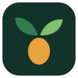
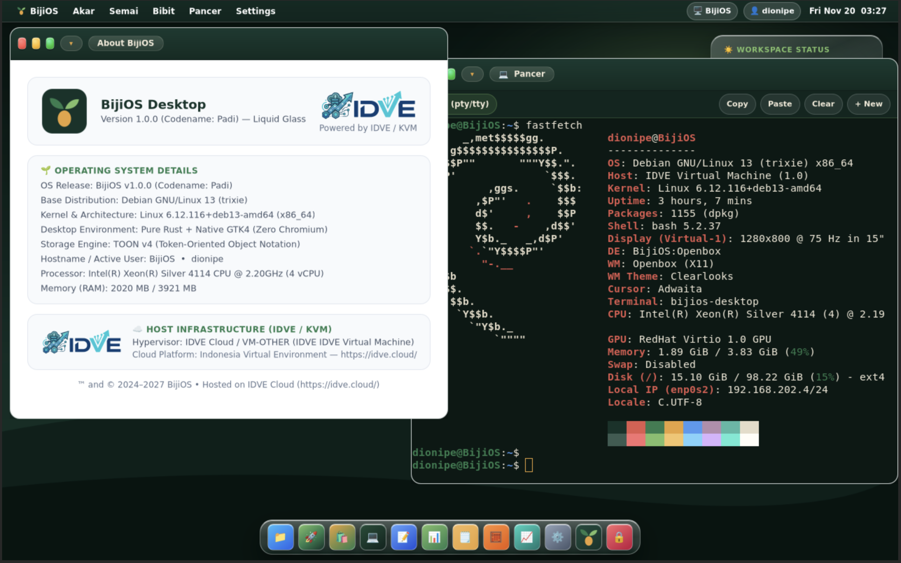

<p align="center">
  
</p>

<h1 align="center">BijiOS Desktop — v1.0.0 ("Padi")</h1>

<p align="center">
  <strong>Full Native Linux Desktop Environment built with 100% Pure Rust + GTK4 &amp; VTE4</strong><br/>
  <em>Liquid Glass Edition • Zero Chromium • Zero External Crates • TOON v4 Storage</em>
</p>

<p align="center">
  
</p>

---

## Overview

**BijiOS Desktop** is a lightweight, sovereign Linux Desktop Environment engineered in **100% Pure Rust** with direct C FFI bindings to **GTK4** and **VTE4** (`libvte-2.91-gtk4`), running over **X11 + Openbox + `xcompmgr`** on Debian 13 (`trixie`).

It features a cohesive botanical identity (**BijiOS v1.0.0 "Padi"**) with macOS-inspired Liquid Glass window chrome, rounded ARGB corners, live Desktop & Dock customization, Dynamic Nature Wallpapers, and seamless native Linux `.deb` application integration.

---

## Brand Palette

| Name | Hex | Role |
| :--- | :--- | :--- |
| **Hijau Tunas** | `#2F7D4F` | Primary accent & active states |
| **Hijau Muda** | `#7FBF6A` | Secondary highlight & growth accent |
| **Krem Tanah** | `#F4EBD9` | Warm light foreground & canvas |
| **Emas Benih** | `#E8A33D` | Seed gold accent & terminal cursor |
| **Hutan Malam** | `#12332A` | Deep forest dark chrome & typography |

---

## Core Native Applications

- **Akar — File Manager**: Sidebar navigation, zebra-striped file table (`Name | Size | Kind`), file-type badges, quick folder/document creation, and storage status bar.
- **Semai — App Launcher**: Proportional squircle launcher combining built-in BijiOS apps and all installed Linux `.deb` applications with instant search.
- **Bibit — Debian App Store**: Curated Debian desktop catalog + live `apt-cache search`, `dpkg-query` status detection, and one-click `pkexec apt-get` install/remove with automatic launcher sync.
- **Pancer — Native Terminal**: Full interactive Linux PTY/TTY `/bin/bash` terminal powered by `libvte-2.91-gtk4` (ANSI 256-color, `vim`, `nano`, `htop`, `sudo`, tab-completion, history, Copy/Paste/Clear).
- **WordCraft, GridCraft, DeckCraft & PDFCraft**: Bundled pure-Rust native office suite by **Storytold / ArtCraft** (Apache License 2.0) — integrated directly into the Dock, **Semai**, and **Akar** file associations (`.docx`, `.xlsx`, `.pptx`, `.pdf`).
- **BijiOS Notes, Calculator & Activity Monitor**: Markdown notes, native calculator, and live `/proc` CPU/RAM/process monitor.
- **System Settings**:
  - **Desktop & Dock**: Live & persisted Dock Size (`32–64 px`), Magnification (`1.0x–1.6x`), Position (`Bottom` / `Left` / `Right`), Minimize Effect (`Genie` / `Scale`), and Animate Opening Applications.
  - **Wallpaper**: Visual preview gallery with **Dynamic Nature Wallpapers** (auto-shifting across Dawn, Day, Sunset, and Night).
  - **General**: OS & Kernel details, **IDVE / KVM** host infrastructure info, Software Update (APT), Storage usage, and Session/Power controls.
  - **Users & Groups**: Active profile, Linux user listing, Add/Edit/Delete user, per-user Change Password, and Group management.
- **Tahoe Liquid Glass Login**: Single-step (`1x`) Linux PAM authentication backed by the local BijiOS Rust daemon.

---

## Project Structure

```text
bijios-desktop/
├── build.rs                 # Direct system library linking (gtk-4, vte-2.91-gtk4, pango, glib)
├── Cargo.toml               # Zero crates.io external dependencies
├── src/
│   ├── main.rs              # Dual-mode binary: HTTP/PAM/TOON daemon & --shell native DE
│   ├── native_de/
│   │   ├── gtk4_ffi.rs      # Pure Rust FFI bindings for GTK4, VTE4, Pango, GLib, GObject
│   │   ├── theme.rs         # BijiOS Liquid Glass GTK4 CSS theme
│   │   ├── mod.rs           # Login screen, Desktop shell, Dock, Widgets & settings persistence
│   │   ├── apps.rs          # Akar, Semai, Bibit, Pancer, WordCraft, GridCraft, Notes, Calc, About
│   │   └── settings.rs      # Sidebar System Settings (Dock, Wallpaper, General, Users & Groups)
│   ├── api/                 # Local PAM auth, OS integration & TOON APIs
│   ├── toon/                # TOON v4 (Token-Oriented Object Notation) database engine
│   ├── docx/ & xlsx/        # Pure Rust OpenXML document & spreadsheet generators
├── static/
│   ├── img/                 # Official BijiOS SVG logos & IDVE host logo
│   └── wallpapers/          # Nature & Dynamic SVG wallpapers
└── packaging/
    ├── build-deb.sh         # Debian (.deb) package builder
    └── deb/                 # LightDM, Openbox, systemd & session scripts
```

---

## Build & Install (Debian 13 / Trixie)

### 1. Install Build Dependencies

```bash
sudo apt-get update
sudo apt-get install -y rustc cargo libgtk-4-dev libvte-2.91-gtk4-dev dpkg-dev
```

### 2. Compile & Build `.deb` Package

```bash
cargo build --release
bash packaging/build-deb.sh
```

### 3. Install on Debian Desktop

```bash
sudo apt-get install -y ./dist/bijios-desktop_1.0.0_amd64.deb
bash packaging/bundle-storytold.sh
sudo systemctl restart lightdm
```

---

## Bundled Open-Source Suite & Credits (Apache License 2.0)

BijiOS Desktop bundles and integrates the following pure Rust office applications under their original names, in compliance with the **Apache License 2.0** (see [THIRD_PARTY_LICENSES.md](THIRD_PARTY_LICENSES.md)):

| Application | Version | Description | Upstream Repository | License |
| :--- | :--- | :--- | :--- | :--- |
| **WordCraft** | `0.18.1` | Clean-room native word processor in pure Rust | https://github.com/storytold/wordcraft | Apache-2.0 |
| **GridCraft** | `0.19.1` | Clean-room native spreadsheet in pure Rust | https://github.com/storytold/gridcraft | Apache-2.0 |
| **DeckCraft** | `0.18.1` | Clean-room native presentation app in pure Rust | https://github.com/storytold/deckcraft | Apache-2.0 |
| **PDFCraft** | `0.21.1` | Native PDF reader & editor written from scratch in Rust | https://github.com/storytold/pdfcraft | Apache-2.0 |

---

## Infrastructure & Credits

- **OS & Desktop**: BijiOS v1.0.0 ("Padi")
- **Bundled Office Suite**: Storytold / ArtCraft ([https://github.com/storytold](https://github.com/storytold)) — Apache License 2.0
- **Cloud & Virtualization Host**: Powered by **IDVE Cloud / KVM** ([https://idve.cloud/](https://idve.cloud/))
